<p align="center">
  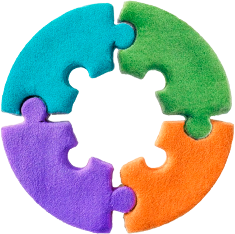
</p>

<h1 align="center">РАСговорилка — бесплатный офлайн-коммуникатор для детей с РАС</h1>

<p align="center">
  <b>Альтернативная и дополнительная коммуникация (AAC) на русском языке</b>
</p>

<p align="center">
  <a href="./LICENSE"></a>
  
  
  
</p>

<p align="center">
  🌐 <b>Приложение:</b> <a href="https://prodilitant-dev.github.io/RASgovorilka/">prodilitant-dev.github.io/RASgovorilka</a>
</p>

<p align="center">
  📦 <b>Android APK:</b> <a href="https://github.com/prodilitant-dev/RASgovorilka-android/releases">Releases</a>
</p>

**РАСговорилка** — это бесплатное веб-приложение для альтернативной и дополнительной коммуникации (AAC). Помогает детям с РАС и другими особенностями развития выражать свои потребности, эмоции и желания с помощью карточек с изображениями и синтеза речи.

Приложение работает **полностью офлайн**, не требует регистрации, не отправляет данные на серверы и устанавливается на телефон или планшет как обычное приложение.

---

## Содержание

- [Зачем это нужно](#зачем-это-нужно)
- [Возможности и режимы](#возможности-и-режимы)
  - [🗣 Сказать](#-сказать)
  - [✍️ Написать](#️-написать)
  - [👍 Да/Нет](#-данет)
  - [📅 Расписание](#-расписание)
  - [🎓 Обучение](#-обучение)
  - [🎮 Игры](#-игры)
  - [📚 Профили](#-профили)
  - [⚙️ Общие](#️-общие)
- [Установка на устройство](#установка-на-устройство)
- [Частые вопросы](#частые-вопросы)
- [Разработка](#разработка)
- [Структура проекта](#структура-проекта)
- [Технологии](#технологии)
- [Лицензия](#лицензия)
- [Обратная связь](#обратная-связь)

---

<details>
<summary><b>💡 Зачем это нужно</b></summary>

<br>

Альтернативная и дополнительная коммуникация (AAC) — это важнейший инструмент, который действительно меняет жизнь детей с расстройствами аутистического спектра (РАС) и их семей. Когда ребёнок не может выразить свои мысли словами, это неизбежно ведёт к сильной фрустрации, которая часто проявляется в виде истерик или самоагрессии. Карточки-символы и специализированные приложения дают ему понятный способ «сказать» о своих потребностях, чувствах и желаниях.

Существует стойкий миф, что использование AAC (например, системы PECS или цифровых планшетов) «обленит» ребёнка, и он не захочет учиться говорить. На деле всё работает иначе: визуальная поддержка стимулирует появление и развитие устной речи, так как связывает образ предмета, его печатное слово и постоянное, чёткое звуковое сопровождение.

Однако коммуникатор — это не панацея. Не получится просто дать ребёнку планшет с установленной программой и ждать, что он сразу заговорит или начнёт общаться. Цифровое устройство или альбом с карточками — лишь инструменты. Без долгого, системного обучения со стороны близких и специалистов, а также без постоянного моделирования (когда взрослые сами используют этот гаджет при общении с ребёнком) планшет останется бесполезной игрушкой, а не средством коммуникации. Запускает речь не само устройство, а правильно выстроенный процесс взаимодействия между ребёнком и окружающими его людьми.

**РАСговорилка** — это:

- 🎯 **Простой интерфейс** — минимум отвлекающих элементов, нейтральное оформление, предсказуемое поведение.
- 📴 **Работает без интернета** — дома, в дороге, в отпуске.
- 🎨 **Кастомизация** — родитель может добавлять свои карточки, категории, изображения и настраивать интерфейс.
- 🔒 **Приватность** — данные не покидают устройство.
- 💸 **Бесплатно и с открытым исходным кодом** — без подписок и скрытых платежей.
- 💾 **Надёжные бэкапы** — экспорт и восстановление индивидуальной базы карточек.
- 🗣 **Нативная озвучка** — синтез речи (TTS) без скачивания тяжёлых аудиофайлов.

<br>

</details>

---

## Возможности и режимы

<details>
<summary><b>🗣 Сказать</b></summary>

<br>

Основной режим коммуникации. Категории сверху, карточки в сетке, панель предложения снизу (или сверху — настраивается в параметрах интерфейса).

- Тап на карточку — добавляет слово в предложение.
- Тап на слово в предложении — удаляет его.
- Кнопка 🔊 — озвучивает всю фразу.
- Кнопка ❌ — очищает предложение.

<details>
<summary>📸 Скрины</summary>

<br>

<a href="./docs/screenshots/say-1.webp" target="_blank">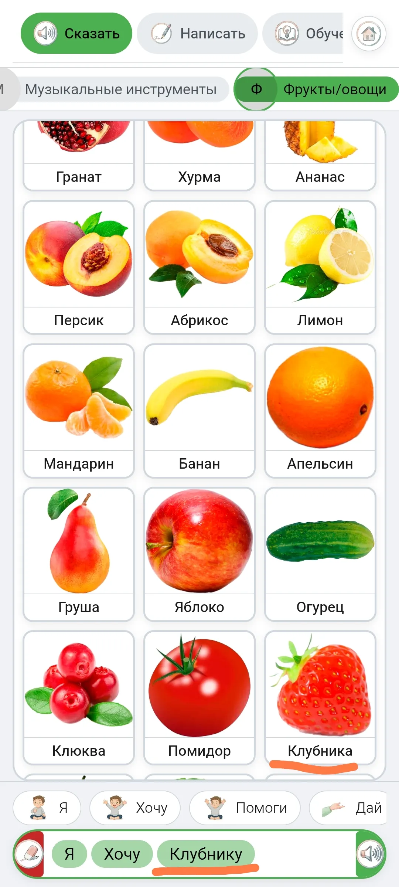</a>
<a href="./docs/screenshots/say-2.webp" target="_blank">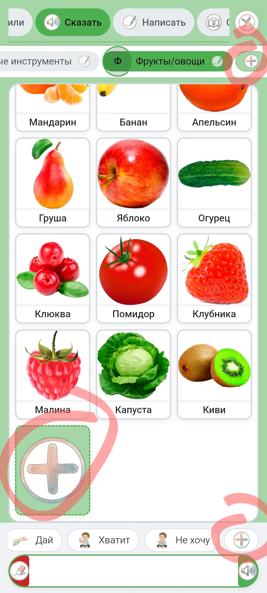</a>
<a href="./docs/screenshots/say-3.webp" target="_blank">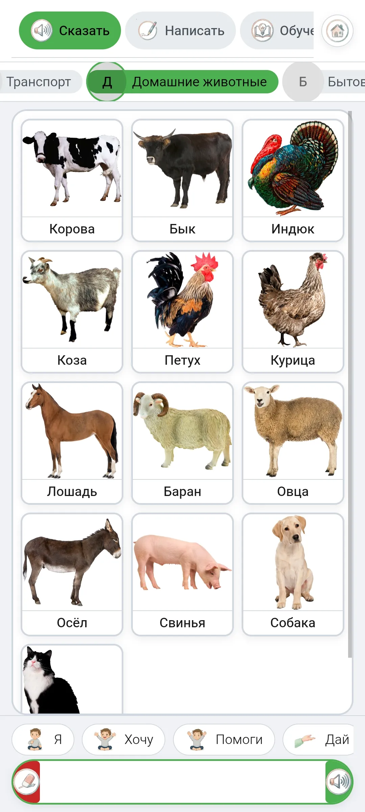</a>
<a href="./docs/screenshots/say-4.webp" target="_blank">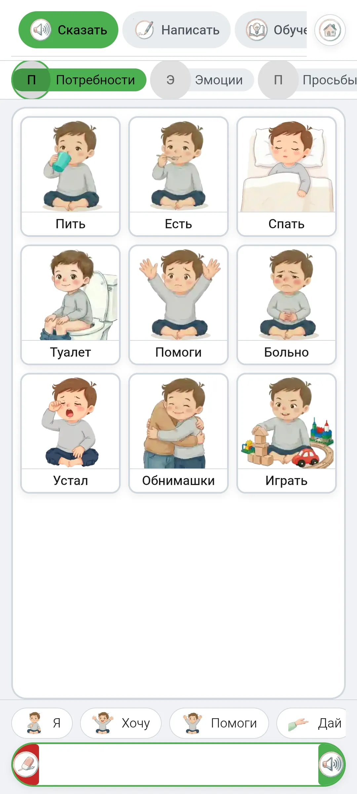</a>

<br>

</details>

<br>

</details>

---

<details>
<summary><b>✍️ Написать</b></summary>

<br>

Свободный ввод текста с синтезом речи. Подходит для детей, которые уже умеют читать и писать, но нуждаются в голосовой поддержке.

Быстрые кнопки над строкой предложения помогают составлять фразы.

<details>
<summary>📸 Скрины</summary>

<br>

<a href="./docs/screenshots/write-1.webp" target="_blank">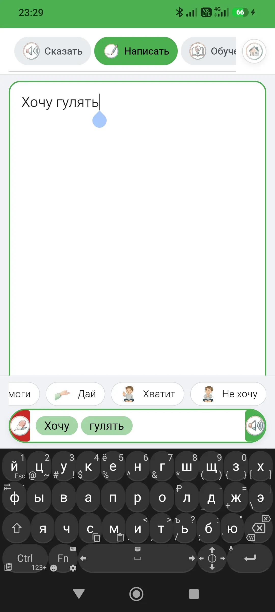</a>
<a href="./docs/screenshots/write-2.webp" target="_blank">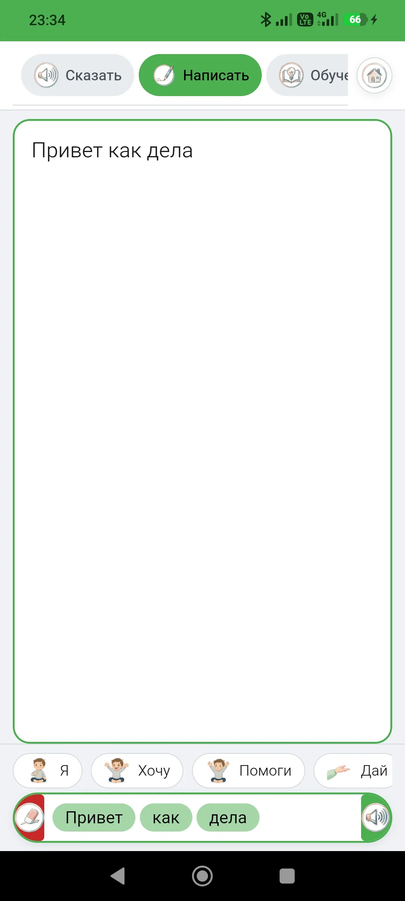</a>

<br>

</details>

<br>

</details>

---

<details>
<summary><b>👍 Да/Нет</b></summary>

<br>

Кнопки для простых ответов — «Да», «Нет», «Не знаю», «Помоги»… Простой интерфейс подходит для детей на начальном этапе обучения или для быстрых ответов в повседневных ситуациях. Кнопки озвучиваются сразу при нажатии. Также можно дополнить: добавить картинку из галереи, сделать фото или просто подобрать подходящее эмодзи.

<details>
<summary>📸 Скрины</summary>

<br>

<a href="./docs/screenshots/yesno-1.webp" target="_blank">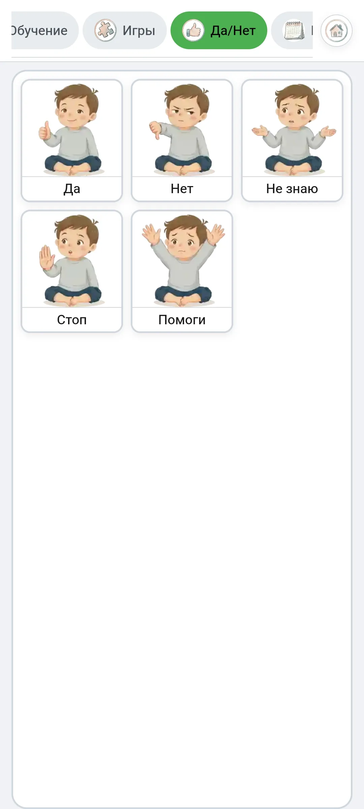</a>
<a href="./docs/screenshots/yesno-2.webp" target="_blank">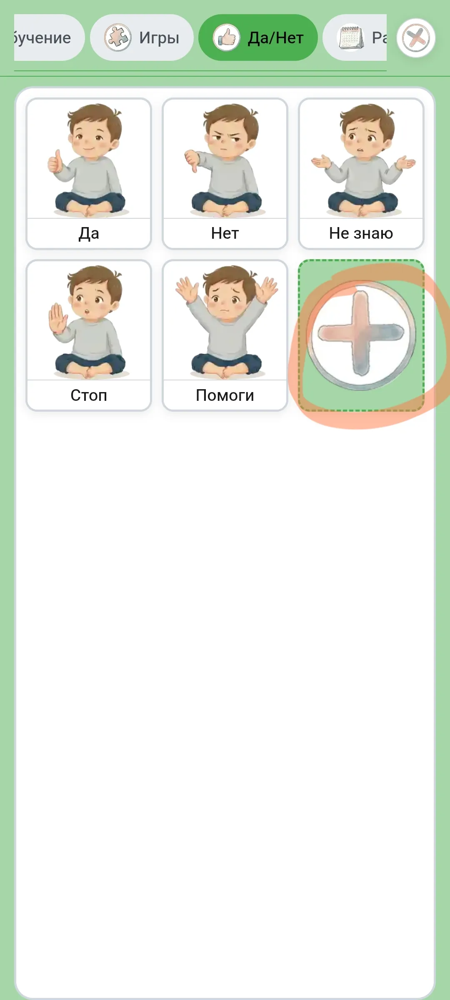</a>
<a href="./docs/screenshots/yesno-3.webp" target="_blank">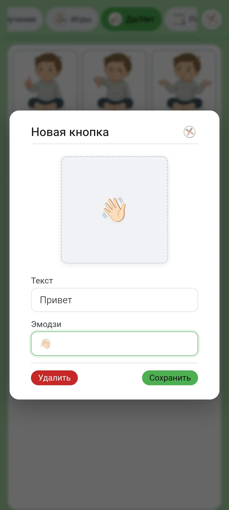</a>
<a href="./docs/screenshots/yesno-4.webp" target="_blank">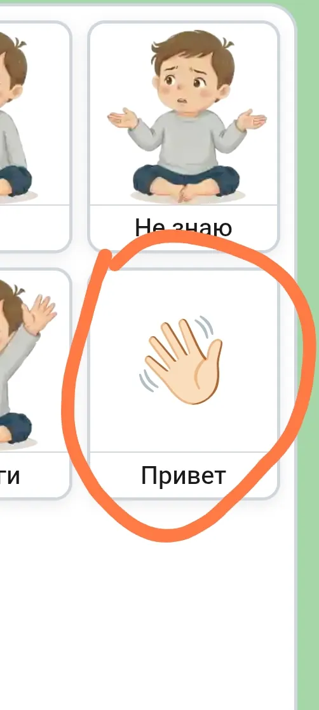</a>

<br>

</details>

<br>

</details>

---

<details>
<summary><b>📅 Расписание</b></summary>

<br>

Визуальное расписание дня. Настраивается на каждый день недели через шаблоны:

- **Будний день** — стандартный набор активностей (подъём, завтрак, садик/школа…)
- **Выходной день** — другой набор (прогулка, игры, свободное время)

Можно создавать свои шаблоны и привязывать к конкретным дням.

<details>
<summary>📸 Скрины</summary>

<br>

<a href="./docs/screenshots/schedule-1.webp" target="_blank">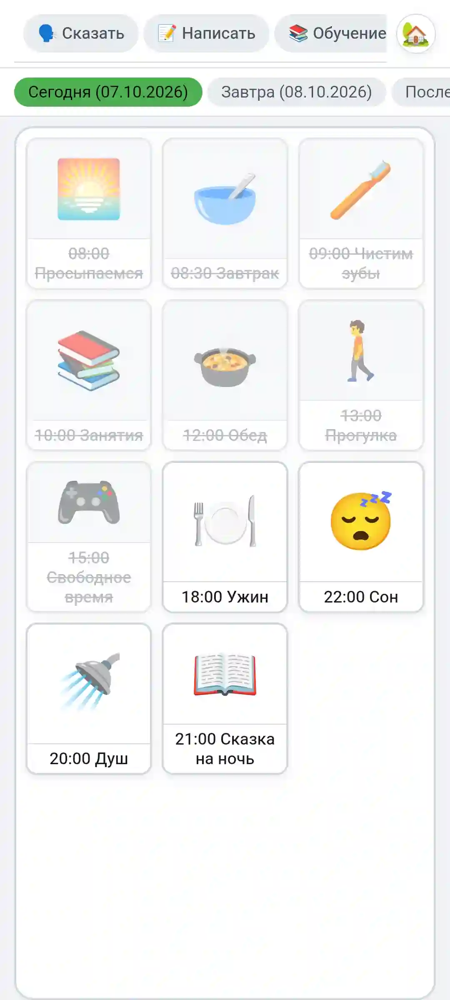</a>
<a href="./docs/screenshots/schedule-2.webp" target="_blank">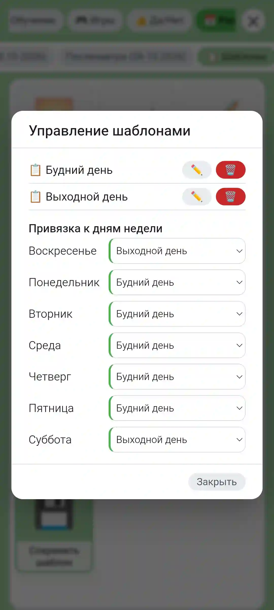</a>

<br>

</details>

<br>

</details>

---

<details>
<summary><b>🎓 Обучение</b></summary>

<br>

Четыре активности для развития речи, мышления и счёта. У каждой игры свои настройки: категории, сложность, количество вопросов.

<details>
<summary><b>🎯 Викторина</b></summary>

<br>

Выбор правильного ответа из нескольких вариантов. Два режима: «Картинка → Слово» и «Слово → Картинка». Настраиваются категории, количество вопросов и вариантов ответа.

<details>
<summary>📸 Скрины</summary>

<br>

<a href="./docs/screenshots/quiz-1.webp" target="_blank">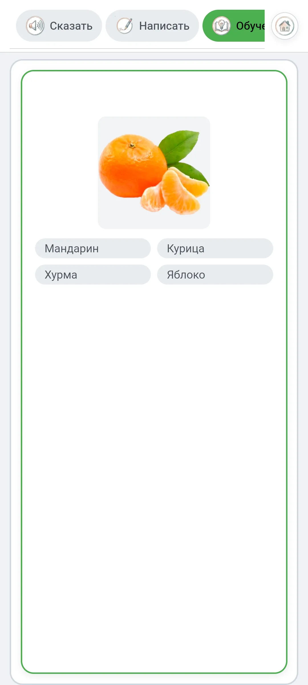</a>
<a href="./docs/screenshots/quiz-2.webp" target="_blank">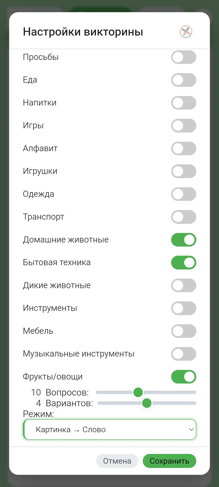</a>
<a href="./docs/screenshots/quiz-3.webp" target="_blank">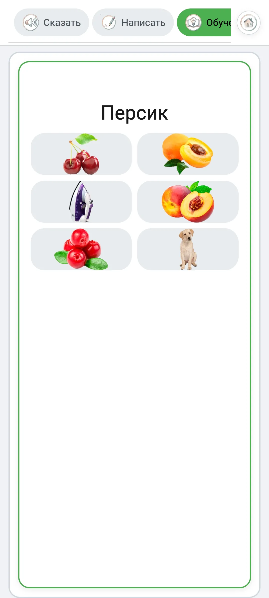</a>
<a href="./docs/screenshots/quiz-4.webp" target="_blank">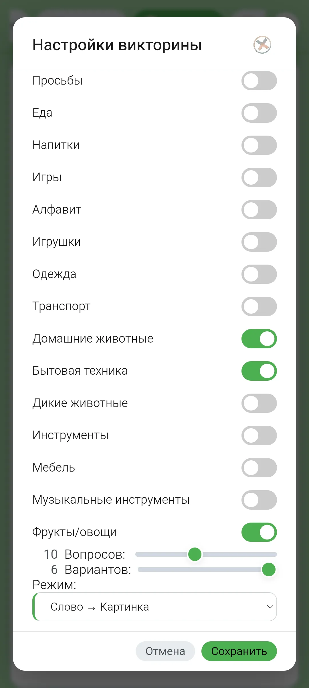</a>

<br>

</details>

</details>

<br>

<details>
<summary><b>🤔 Угадайка</b></summary>

<br>

Развитие номинативной функции речи. Задания на определение объекта по изображению с последующим вводом слова. Помогают связать визуальный образ с текстовым написанием, развивая образное мышление и словарный запас.

<details>
<summary>📸 Скрины</summary>

<br>

<a href="./docs/screenshots/guess-1.webp" target="_blank">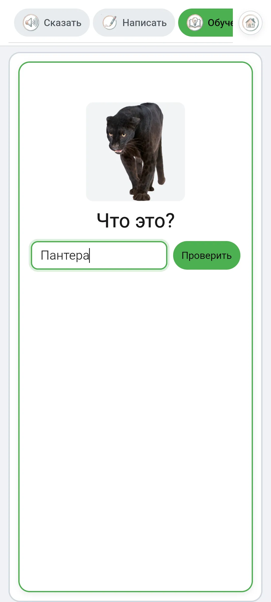</a>
<a href="./docs/screenshots/guess-2.webp" target="_blank">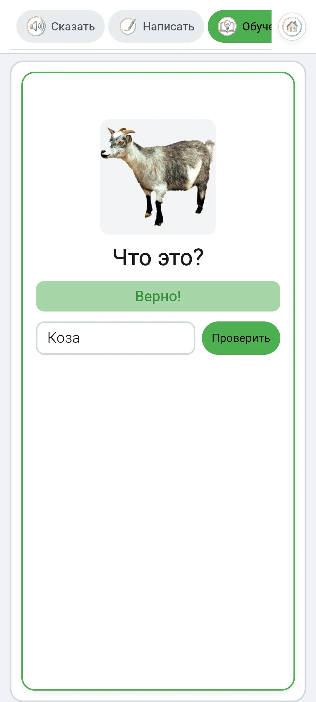</a>
<a href="./docs/screenshots/guess-3.webp" target="_blank">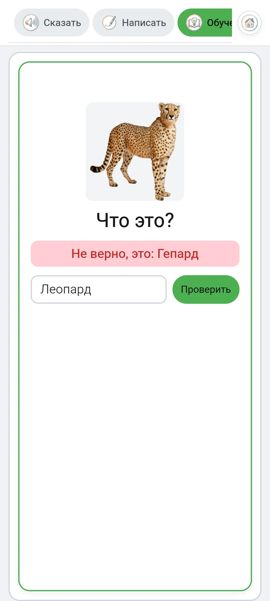</a>
<a href="./docs/screenshots/guess-4.webp" target="_blank">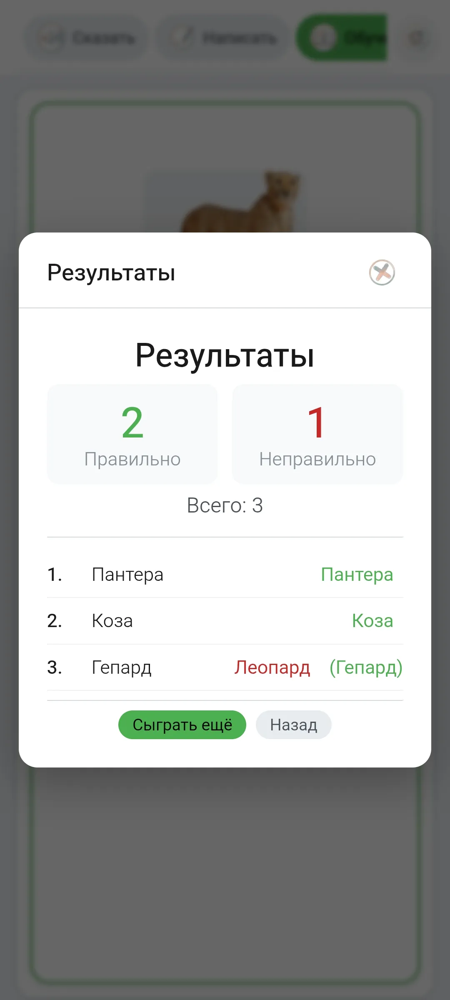</a>

<br>

</details>

</details>

<br>

<details>
<summary><b>🧩 Сортировка</b></summary>

<br>

Интерактивная сортировка по смысловым группам. Ребёнок учится распределять карточки по соответствующим категориям (например, отделять «Еду» от «Игрушек»). Упражнение активно тренирует логическое мышление, помогает структурировать восприятие окружающего мира и развивает важнейший навык обобщения и классификации предметов.

<details>
<summary>📸 Скрины</summary>

<br>

<a href="./docs/screenshots/sorting-1.webp" target="_blank">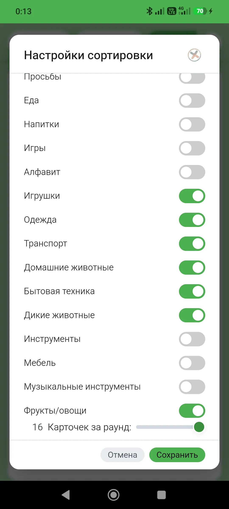</a>
<a href="./docs/screenshots/sorting-2.webp" target="_blank">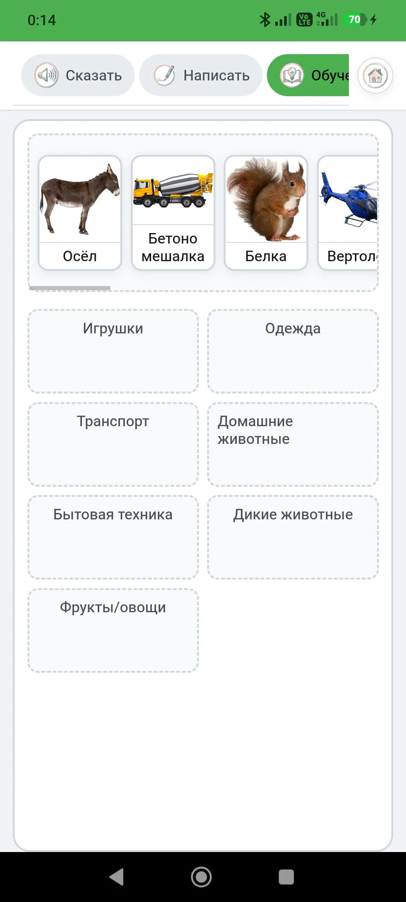</a>
<a href="./docs/screenshots/sorting-3.webp" target="_blank">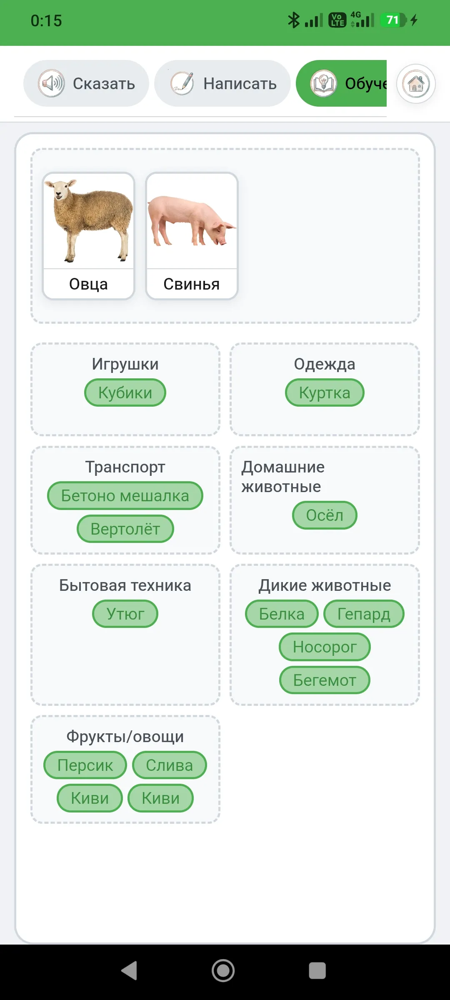</a>
<a href="./docs/screenshots/sorting-4.webp" target="_blank">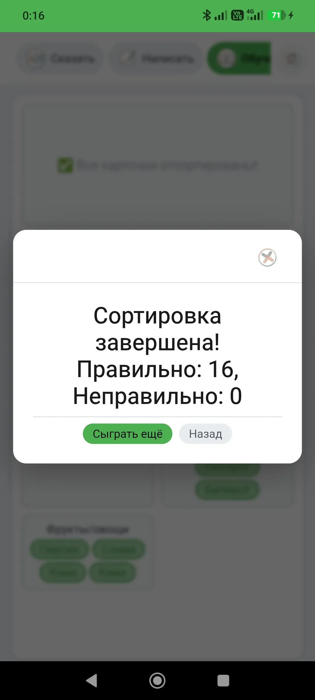</a>

<br>

</details>

</details>

<br>

<details>
<summary><b>➕ Математика</b></summary>

<br>

Простые вычисления, которые легко адаптировать под уровень ребёнка. Можно настроить доступные арифметические операции, задать максимальный диапазон чисел (от 5 до 50) и выбрать способ ввода ответа: классический ввод цифр или простое перетаскивание правильного варианта.

<details>
<summary>📸 Скрины</summary>

<br>

<a href="./docs/screenshots/math-1.webp" target="_blank">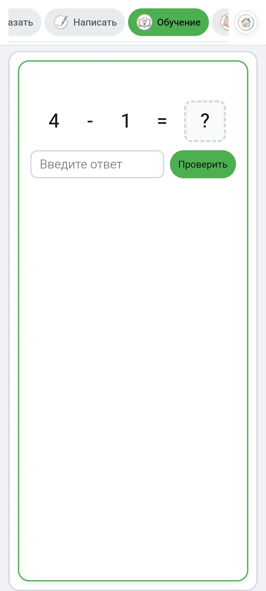</a>
<a href="./docs/screenshots/math-2.webp" target="_blank">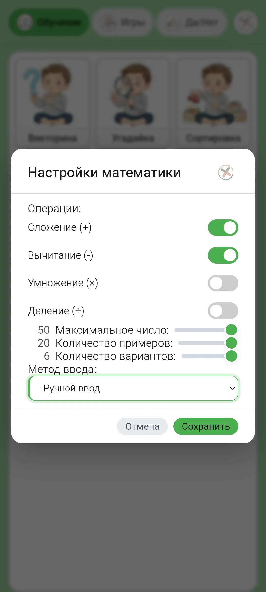</a>
<a href="./docs/screenshots/math-3.webp" target="_blank">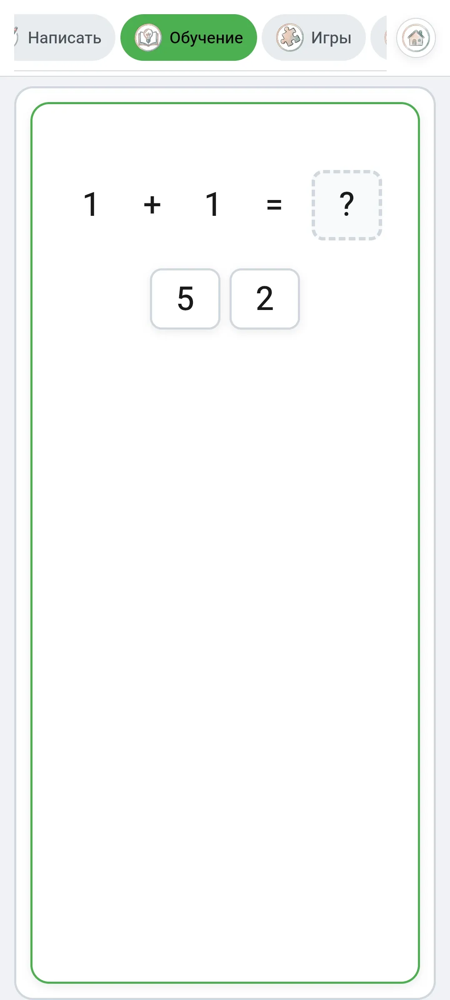</a>
<a href="./docs/screenshots/math-4.webp" target="_blank">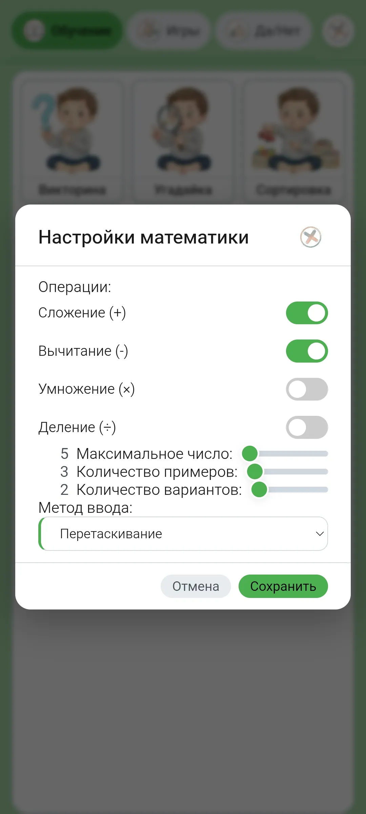</a>

<br>

</details>

</details>

<br>

</details>

---

<details>
<summary><b>🎮 Игры</b></summary>

<br>

Развлекательные игры для тренировки памяти и логики. Каждая игра настраивается отдельно.

<details>
<summary><b>🃏 Мемори</b></summary>

<br>

Развивающая игра на поиск одинаковых изображений. Эффективный тренажёр для улучшения кратковременной памяти и зрительного внимания. Ребёнок ищет и сопоставляет пары скрытых карточек, удерживая образы в голове. Гибкая настройка размеров сетки (от простых 4×4 до продвинутых 6×6 и 8×8) позволяет превратить занятие в увлекательный процесс с постепенным усложнением задач.

<details>
<summary>📸 Скрины</summary>

<br>

<a href="./docs/screenshots/memory-1.webp" target="_blank">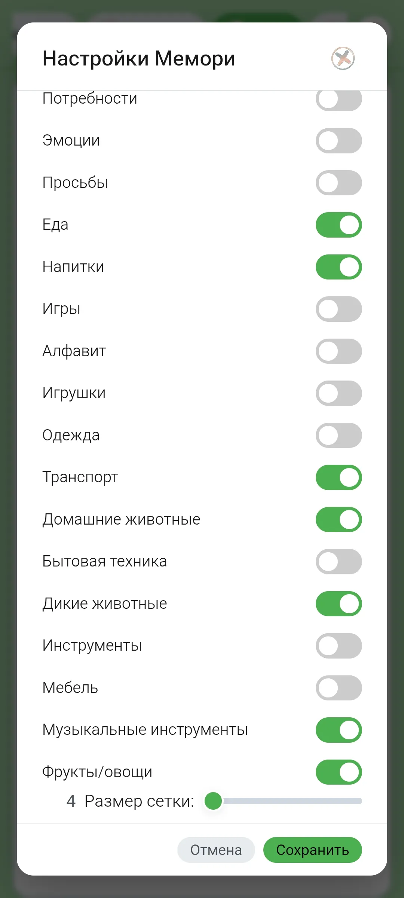</a>
<a href="./docs/screenshots/memory-2.webp" target="_blank">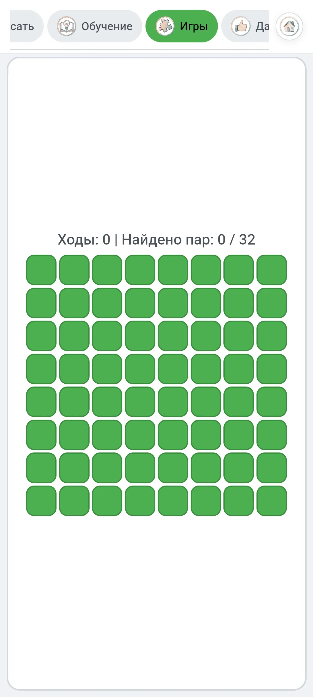</a>
<a href="./docs/screenshots/memory-3.webp" target="_blank">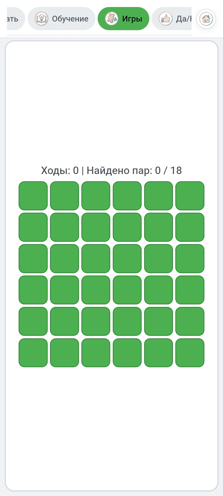</a>
<a href="./docs/screenshots/memory-4.webp" target="_blank">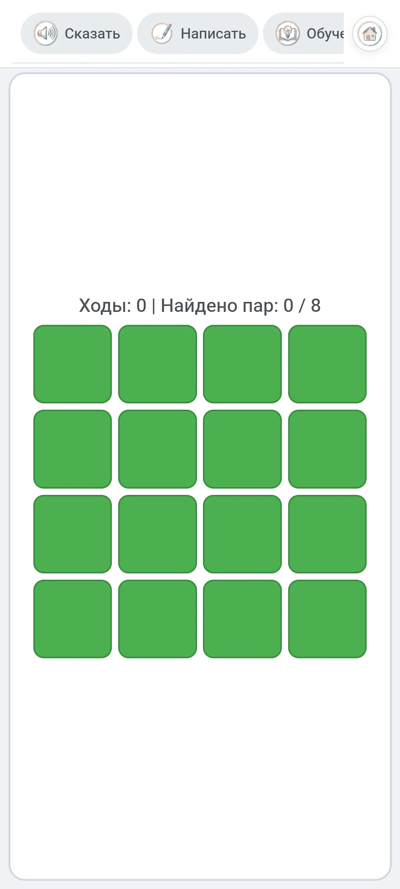</a>

<br>

</details>

</details>

<br>

<details>
<summary><b>🔢 Пятнашки</b></summary>

<br>

Интерактивные «Пятнашки» (классическая числовая головоломка). Увлекательная игра, направленная на развитие логического мышления, пространственного ориентирования и навыков порядкового счёта. Ребёнок учится выстраивать числа в правильной последовательности, перемещая их по игровому полю. Адаптивная сетка гибко настраивается в диапазоне от 4×4 до 8×8, что позволяет плавно повышать сложность задачи по мере развития навыков.

<details>
<summary>📸 Скрины</summary>

<br>

<a href="./docs/screenshots/fifteen-1.webp" target="_blank">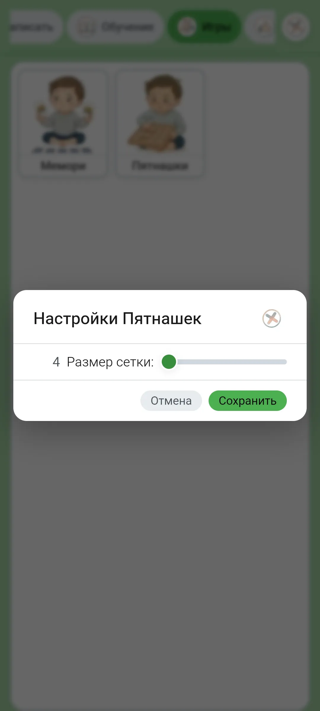</a>
<a href="./docs/screenshots/fifteen-2.webp" target="_blank">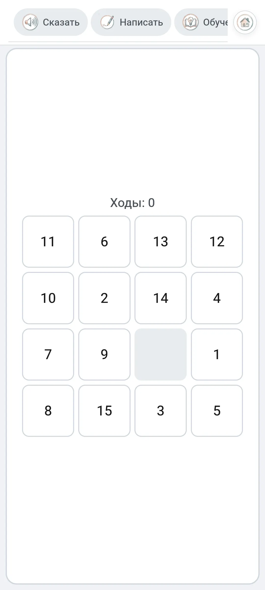</a>
<a href="./docs/screenshots/fifteen-3.webp" target="_blank">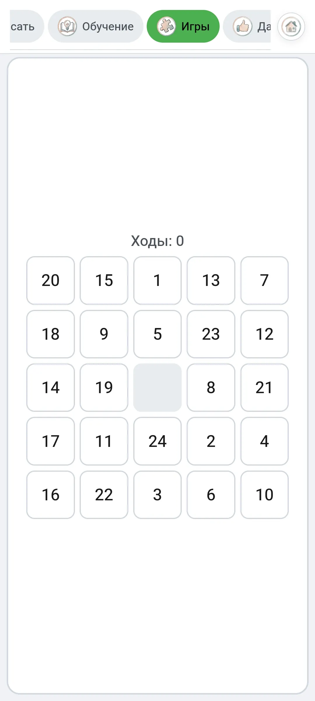</a>
<a href="./docs/screenshots/fifteen-4.webp" target="_blank">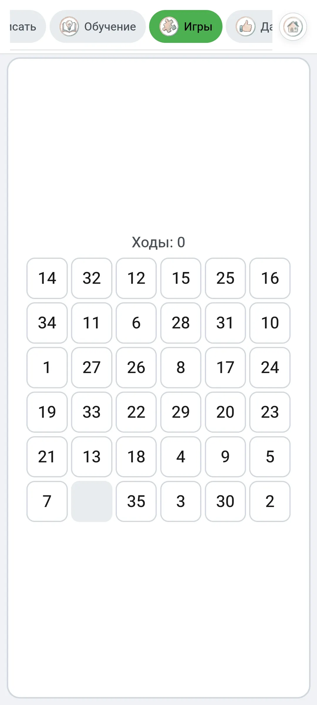</a>
<a href="./docs/screenshots/fifteen-5.webp" target="_blank">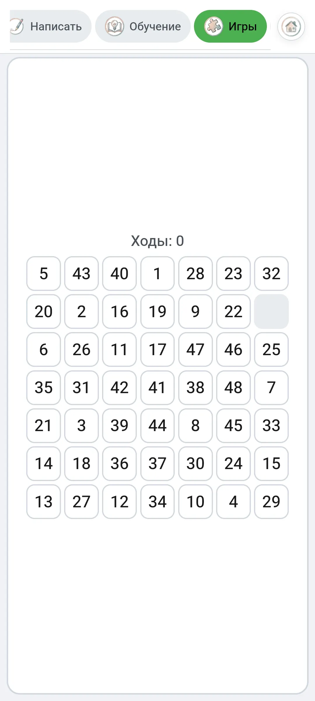</a>
<a href="./docs/screenshots/fifteen-6.webp" target="_blank">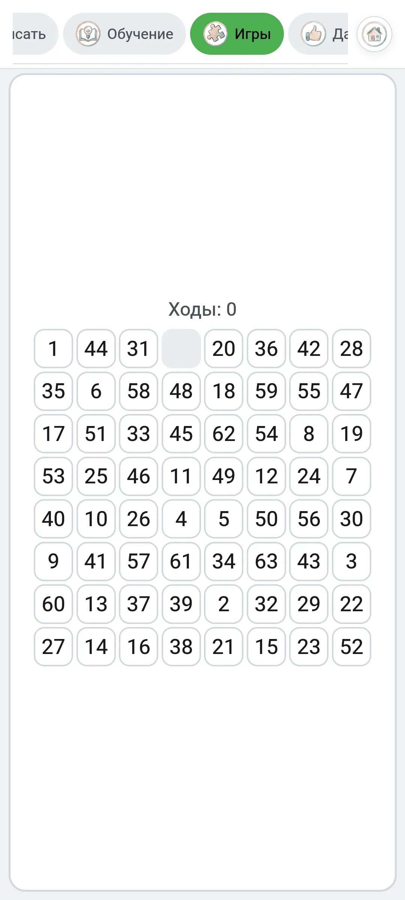</a>

<br>

</details>

</details>

<br>

</details>

---

<details>
<summary><b>📚 Профили</b></summary>

<br>

Многопрофильная система. У каждого ребёнка или жизненной ситуации должна быть своя уникальная база карточек. Приложение позволяет создавать индивидуальные профили вручную, присваивая им имя и узнаваемую иконку. Это идеальное решение для специалистов (логопедов, АВА-терапевтов), которые могут вести нескольких учеников на одном устройстве, а также для родителей, переключающих наборы карточек в зависимости от локации (например, профиль «Дом», «Школа» или «Детская площадка»).

<details>
<summary>📸 Скрины</summary>

<br>

<a href="./docs/screenshots/profiles-1.webp" target="_blank">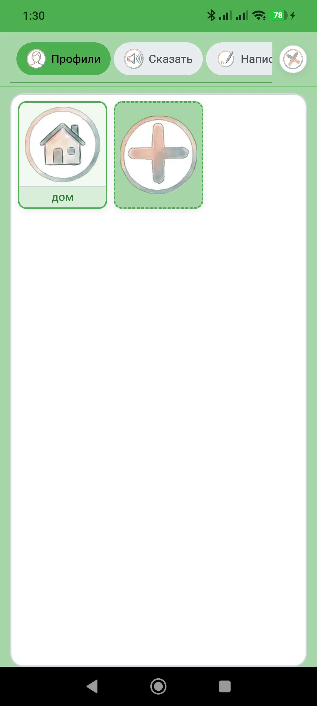</a>
<a href="./docs/screenshots/profiles-2.webp" target="_blank">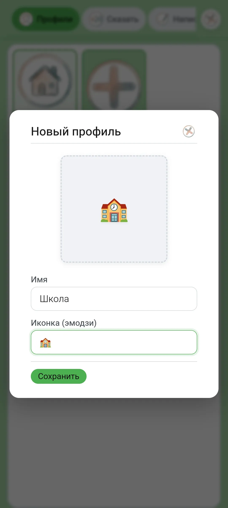</a>
<a href="./docs/screenshots/profiles-3.webp" target="_blank">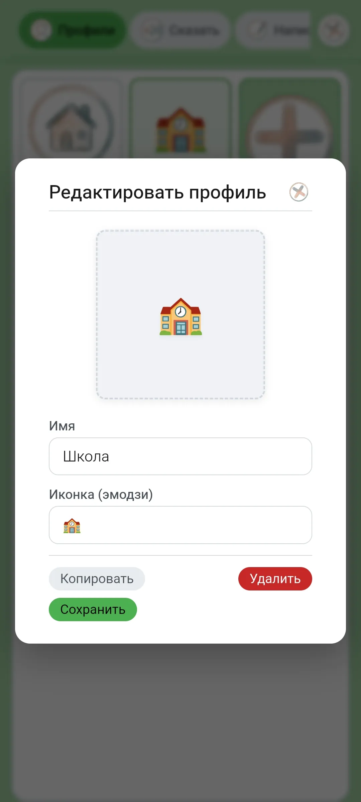</a>
<a href="./docs/screenshots/profiles-4.webp" target="_blank">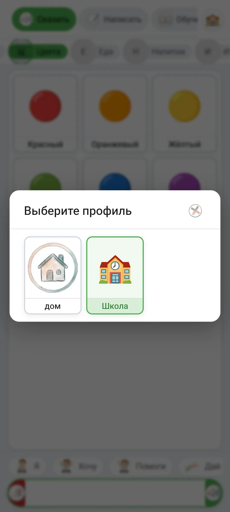</a>

<br>

</details>

<br>

</details>

---

<details>
<summary><b>⚙️ Общие</b></summary>

<br>

Общие настройки приложения: полноэкранный режим, голос, интерфейс, автосклонение, управление данными. Все параметры сохраняются автоматически и применяются сразу.

<details>
<summary><b>🔊 Голос</b></summary>

<br>

Управление параметрами звукового сопровождения. Модуль настройки TTS позволяет быстро адаптировать звучание под сенсорные особенности конкретного ребёнка, изменяя:

- скорость (0.5–2.0)
- тональность (0.5–2.0)
- громкость (0–1)

В приложении нет встроенного синтезатора речи. Вместо этого «РАСговорилка» напрямую обращается к возможностям системы устройства. Это позволило сделать приложение максимально лёгким и быстрым, а также исключило перегрузку интерфейса лишними переключателями.

</details>

<br>

<details>
<summary><b>🎨 Интерфейс</b></summary>

<br>

Модальное окно настройки интерфейса с четырьмя подразделами:

- **Режимы** — порядок и видимость кнопок на панели режимов
- **Панель предложения** — сверху или снизу (рекомендуется **сверху** на Android, чтобы ребёнок не задел системный жест снизу)
- **Категории** — показывать или скрывать иконки категорий
- **Голос** — настройки синтеза речи

<details>
<summary>📸 Скрины</summary>

<br>

<a href="./docs/screenshots/modes-1.webp" target="_blank">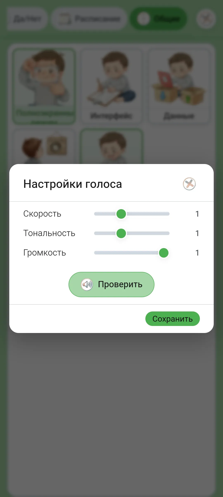</a>
<a href="./docs/screenshots/modes-2.webp" target="_blank">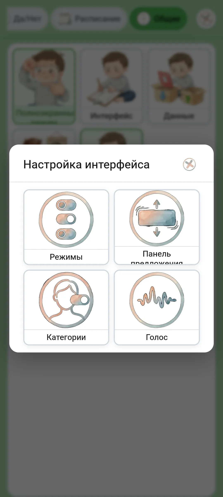</a>
<a href="./docs/screenshots/modes-3.webp" target="_blank">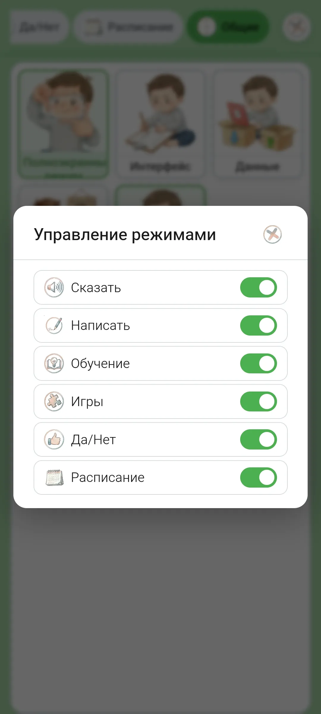</a>
<a href="./docs/screenshots/modes-4.webp" target="_blank">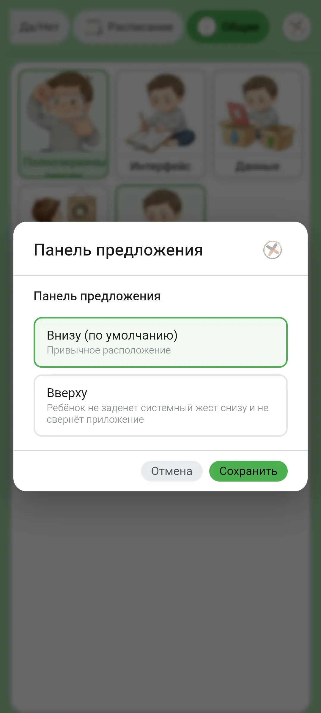</a>
<a href="./docs/screenshots/modes-5.webp" target="_blank">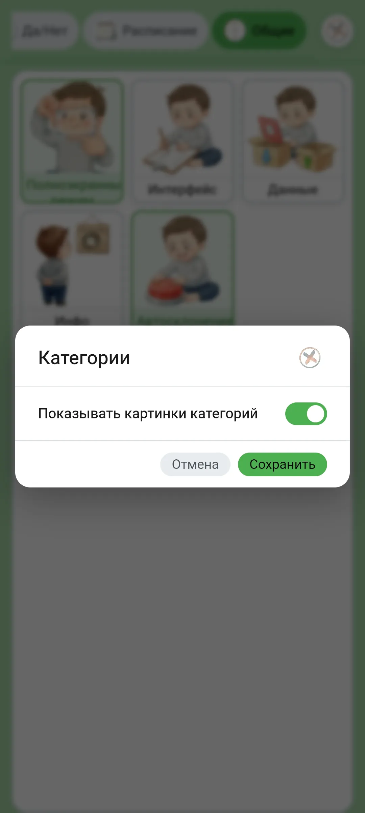</a>

<br>

</details>

</details>

<br>

<details>
<summary><b>📖 Автосклонение</b></summary>

<br>

Автоматическое согласование падежных форм. Уникальная функция, которая решает главную проблему аналогичных коммуникаторов — грамматически некорректное звучание фраз. При активации режим автоматически сканирует базу карточек и генерирует для них правильные падежные окончания (родительный, дательный, винительный и т.д.). Алгоритм умно распознаёт и склоняет прилагательные, автоматически подстраивая их под мужской, женский или средний род (например, на основе карточки «красный» система выдаст: «красный мяч», «красная машина», «красное яблоко»). Благодаря этому приложение озвучивает предложения естественно и грамматически верно, что крайне важно для формирования правильного речевого слуха у ребёнка.

Модуль работает полностью автономно и офлайн, ему не нужен доступ к интернету или внешним словарям. Поскольку русский язык богат на исключения, которые невозможно просчитать на 100%, автоматика не ограничивает кастомизацию: если вы измените форму сложного слова вручную, приложение запомнит её и будет использовать именно ваш приоритетный вариант.

<details>
<summary>📸 Скрины</summary>

<br>

<a href="./docs/screenshots/inflect-1.webp" target="_blank">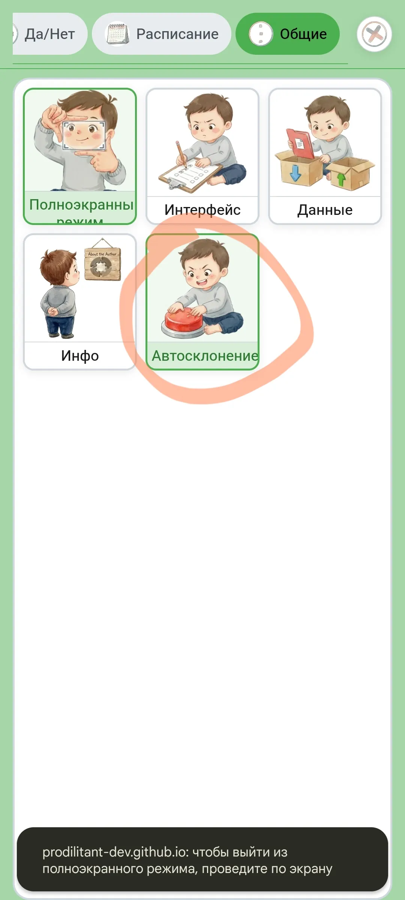</a>
<a href="./docs/screenshots/inflect-2.webp" target="_blank">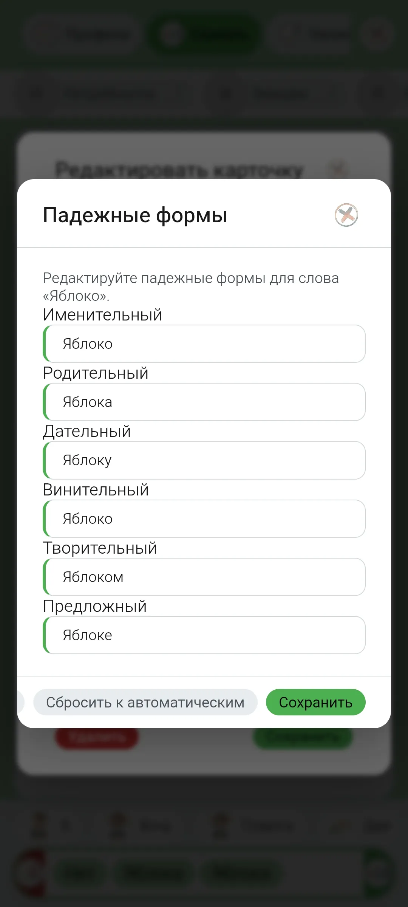</a>
<a href="./docs/screenshots/inflect-3.webp" target="_blank"></a>
<a href="./docs/screenshots/inflect-4.webp" target="_blank"></a>
<a href="./docs/screenshots/inflect-5.webp" target="_blank"></a>
<a href="./docs/screenshots/inflect-6.webp" target="_blank"></a>

<br>

</details>

</details>

<br>

<details>
<summary><b>🖥️ Полноэкранный режим</b></summary>

<br>

(Full Screen). Опция полностью скрывает нативные системные панели операционной системы (верхний статус-бар и нижнюю панель навигации устройства), предоставляя всё пространство экрана под интерфейс приложения.

Из-за встроенных ограничений безопасности PWA-архитектуры приложение не может принудительно открыться во весь экран само по себе. Поэтому при каждом новом открытии приложения полноэкранный режим активируется автоматически при первом же касании экрана (если тумблер включён в настройках). Функция направлена на максимальную концентрацию внимания ребёнка и защиту от случайных нажатий. При этом интерфейс телефона скрывается, но не блокируется аппаратно: родитель или специалист в любой момент может вызвать навигационные панели стандартным свайпом от края дисплея.

</details>

<br>

<details>
<summary><b>💾 Данные</b></summary>

<br>

**Управление данными и обновления.** Комплексный модуль для обеспечения полной сохранности ваших данных и поддержания приложения в актуальном состоянии.

Он включает в себя:

- **Резервное копирование (Импорт и Экспорт):**
  - **Экспорт:** позволяет выбрать, какие именно данные сохранить — одну или несколько конкретных категорий карточек отдельно, либо всю базу целиком вместе с настройками профиля. Это удобно для обмена наборами карточек между специалистами и родителями.
  - **Импорт:** данные загружаются строго в текущий выбранный профиль. При этом вы можете выбрать один из трёх режимов интеграции: **добавить** новые карточки к существующим, **обновить** текущие или полностью **перезаписать** профиль из бэкапа.
  - **Портативность:** позволяет легко и без потери прогресса переносить профили и наборы карточек ребёнка между разными смартфонами и планшетами.
- **Полный сброс:** при необходимости позволяет мгновенно очистить базу и вернуть приложение к первоначальным заводским настройкам.
- **Обновления:** благодаря архитектуре PWA «РАСговорилка» способна работать полностью автономно. Когда телефон или планшет подключены к сети, приложение автоматически проверяет наличие новых версий и незаметно подтягивает их в фоновом режиме без ручной переустановки. Если устройство используется в основном офлайн, родителю достаточно разово подключить его к интернету и нажать кнопку «Обновление», чтобы мгновенно установить свежее обновление.

<details>
<summary>📸 Скрины</summary>

<br>

<a href="./docs/screenshots/backup-1.webp" target="_blank"></a>
<a href="./docs/screenshots/backup-2.webp" target="_blank"></a>
<a href="./docs/screenshots/backup-3.webp" target="_blank"></a>

<br>

</details>

</details>

<br>

</details>

---

<details>
<summary><b>📲 Установка на устройство</b></summary>

<br>

### Android (Chrome, Edge, Samsung Internet)

1. Откройте https://prodilitant-dev.github.io/RASgovorilka/ в браузере.
2. Тапните меню браузера (⋮) → **«Установить приложение»** (или **«Добавить на главный экран»**).
3. Подтвердите — иконка появится на домашнем экране.

### iOS (Safari)

1. Откройте приложение в Safari.
2. Нажмите кнопку **«Поделиться»** (иконка со стрелкой вверх) → **«На экран "Домой"»**.
3. Подтвердите.

> ℹ️ Приложение **не тестировалось на iOS**. Разработка ориентирована в первую очередь на устройства Android. Если у вас есть опыт использования «РАСговорилки» на iPhone или iPad — буду рад обратной связи.

### Десктоп (Chrome, Edge)

1. Откройте URL приложения в браузере.
2. В правой части адресной строки появится иконка установки — нажмите её.
3. Либо откройте меню браузера → **«Установить РАСговорилка»**.

---

### 📦 Установка через APK (Android, бета)

Для удобства ручной передачи приложения можно установить его из APK-файла.

**Что это за файл.** Это **TWA (Trusted Web Activity)** — Android-обёртка, собранная через [Bubblewrap](https://github.com/GoogleChromeLabs/bubblewrap). Приложение открывает веб-версию в полноэкранном режиме, без адресной строки браузера. Это **не нативная разработка**, а лёгкий клиент вокруг того же веб-приложения.

- ✅ **Полноэкранный режим** — статус-бар и навигация Android скрыты, панели можно вызвать только свайпом от края
- ✅ **Экран не гаснет**, пока приложение открыто
- ✅ **Устанавливается офлайн** — при первом запуске интернет не нужен: Service Worker и статика уже внутри пакета
- ✅ **Обновляется автоматически** — при появлении сети подтягивает свежую версию с сайта. Также можно обновить вручную кнопкой «Обновление» внутри приложения
- ⚠️ **Google Play не принимает TWA для детей до 13 лет.** Файл предназначен для ручной установки из GitHub Releases
- 📱 **Минимальная версия Android:** 7.0 (API 24)

**📥 Скачать APK:** [RASgovorilka-0.9.8.apk](https://github.com/prodilitant-dev/RASgovorilka-android/releases/download/v0.9.8/RASgovorilka-0.9.8.apk)

**Все версии:** [раздел Releases](https://github.com/prodilitant-dev/RASgovorilka-android/releases)

**Исходный код Android-обёртки:** [prodilitant-dev/RASgovorilka-android](https://github.com/prodilitant-dev/RASgovorilka-android)

</details>

---

<details>
<summary><b>❓ Частые вопросы</b></summary>

<br>

**Это безопасно для ребёнка?**
Да. Приложение работает полностью офлайн, не требует регистрации, не собирает данные и не отправляет их на серверы. Всё хранится только на вашем устройстве.

**Нужен ли интернет?**
Нет. После установки приложение работает без интернета. Интернет нужен только для первоначальной установки и обновлений.

**Сколько стоит?**
Бесплатно. Без подписок, рекламы и скрытых платежей. Исходный код открыт под лицензией GPL-3.0.

**Подходит ли для неговорящего ребёнка?**
Да. РАСговорилка создана именно для этого. Ребёнок нажимает на карточку — приложение озвучивает её.

**Можно ли на iPhone или iPad?**
Разработка ориентирована на Android. На iOS может работать, но не тестировалось. Если попробуете — напишите, как всё прошло.

**Можно ли установить как обычное приложение на Android?**
Да. РАСговорилка устанавливается как PWA прямо из браузера (Chrome → «Установить приложение»). Дополнительно доступен APK — см. раздел «Установка через APK» выше.

**Как добавить свои карточки?**
В режиме редактирования: долгое нажатие на карточку или через настройки. Можно добавить текст, эмодзи, картинку и указать тип слова для автосклонения.

**Почему приложение бесплатное?**
Его создаёт отец ребёнка с РАС — для своего сына и для других семей. Добро должно быть доступным.

</details>

---

<details>
<summary><b>🛠 Разработка</b></summary>

<br>

### Требования

- **Node.js** ≥ 18 (рекомендуется 22 LTS)
- **npm** ≥ 9
- **Git** с доступом по SSH (для push)

### Установка

```bash
git clone git@github.com:prodilitant-dev/RASgovorilka.git
cd RASgovorilka
npm install
```

### Запуск dev-сервера

```bash
npm run dev
```

Откройте в браузере: http://localhost:3000/RASgovorilka/

### Сборка

```bash
npm run build
```

Готовые файлы появятся в директории `dist/`.

### Предпросмотр сборки

```bash
npm run preview
```

### Проверка и форматирование кода

```bash
npm run lint          # ESLint: проверка кода
npm run format:check  # Prettier: только проверка форматирования
npm run format        # Prettier: автоматическое форматирование
npm run lint:fix      # ESLint: автоматическое исправление ошибок
```

</details>

<details>
<summary><b>📁 Структура проекта</b></summary>

<br>

```text
RASgovorilka/
├── .github/workflows/       # CI и деплой на GitHub Pages
├── docs/                    # Документация и скриншоты
│   └── screenshots/
├── src/
│   ├── app/                 # Инициализация, рендер, синхронизация состояния
│   │   ├── handlers/        # Обработчики профилей
│   │   ├── helpers/         # Утилиты профилей
│   │   └── renderers/       # Рендер приложения и контента
│   ├── components/          # Переиспользуемые компоненты
│   │   ├── Header/
│   │   ├── MainArea/
│   │   ├── ModeBar/
│   │   ├── Profile/
│   │   └── common/          # Card, Grid, Modal, VerticalEditor, ImageCropper…
│   ├── config/              # Дефолтные данные (карточки, категории, режимы)
│   ├── modes/               # Режимы приложения
│   │   ├── say/             # Сказать
│   │   ├── write/           # Написать
│   │   ├── yesno/           # Да/Нет
│   │   ├── schedule/        # Расписание
│   │   ├── learning/        # Обучение (quiz, guess, sorting, math)
│   │   ├── games/           # Игры (memory, fifteen)
│   │   ├── profiles/        # Список профилей
│   │   └── general/         # Общие настройки
│   ├── public/              # Статика (иконки, карточки)
│   ├── services/            # Сервисы (backup, image, pwa)
│   ├── state/               # Глобальное состояние (store, actions)
│   ├── storage/             # Работа с IndexedDB
│   ├── styles/              # CSS в подпапках
│   │   ├── layout/
│   │   ├── cards/
│   │   ├── forms/
│   │   ├── modals/
│   │   ├── editor/
│   │   ├── common/
│   │   └── modes/
│   ├── utils/               # Утилиты (inflect, image, speech, dom…)
│   ├── index.html           # HTML-точка входа
│   └── main.js              # JS-точка входа
├── .editorconfig
├── .gitignore
├── .prettierrc.json
├── eslint.config.js
├── package.json
├── vite.config.js
└── README.md
```

</details>

<details>
<summary><b>🧰 Технологии</b></summary>

<br>

| Слой            | Технология                    |
| :-------------- | :---------------------------- |
| **Язык**        | JavaScript (ES2022, ESM)      |
| **Сборщик**     | Vite 8                        |
| **PWA**         | vite-plugin-pwa 2 (Workbox)   |
| **Хранилище**   | IndexedDB через idb           |
| **Архивы**      | JSZip                         |
| **Синтез речи** | Web Speech API                |
| **Линтер**      | ESLint 10 + unused-imports    |
| **Форматтер**   | Prettier 3                    |
| **CI/CD**       | GitHub Actions → GitHub Pages |

> 💡 **Без фреймворков.** Только ванильный JS + точечные зависимости. Это осознанный выбор: минимальный размер бандла, предсказуемое поведение и полное отсутствие скрытой «магии».

</details>

<details>
<summary><b>📄 Лицензия</b></summary>

<br>

Проект распространяется под лицензией **GNU General Public License v3.0 or later (GPL-3.0-or-later)**.

Это значит:

- ✅ Вы можете свободно использовать, изучать, изменять и распространять этот продукт.
- ✅ Разрешено использование проекта в коммерческих целях.
- ⚠️ Любые производные работы обязаны оставаться открытыми под точно такой же лицензией.
- ⚠️ Все внесённые изменения должны быть чётко задокументированы.

Полный текст лицензии доступен в файле [LICENSE](LICENSE).

</details>

<details>
<summary><b>💌 Обратная связь</b></summary>

<br>

- **Баг-трекер (Issues):** [github.com/prodilitant-dev/RASgovorilka/issues](https://github.com/prodilitant-dev/RASgovorilka/issues)
- **Telegram-канал:** [@RASgovorilka](https://t.me/RASgovorilka)
- **MAX-канал:** [@RASgovorilka](https://max.ru/channel_RASgovorilka)
- **Telegram (личные сообщения):** [@akvariumist2gr](https://t.me/akvariumist2gr)
- **Email:** prodilitant@gmail.com

Если приложение оказалось полезным — пожалуйста, расскажите об этом. Ваши истории — это лучшая мотивация для дальнейшего развития проекта.

Выражаю огромную благодарность всем родителям, практикующим специалистам и волонтёрам, которые ежедневно трудятся и растят особенных детей.

Этот проект создан на чистом энтузиазме и с верой в то, что добро должно быть доступным. Я искренне верю: чем больше в мире будет подобных приложений со свободным и бесплатным распространением, тем легче и лучше станет жизнь семей, столкнувшихся с трудностями.

<p align="center">Сделано с ❤️ для детей и их родителей</p>

</details>
